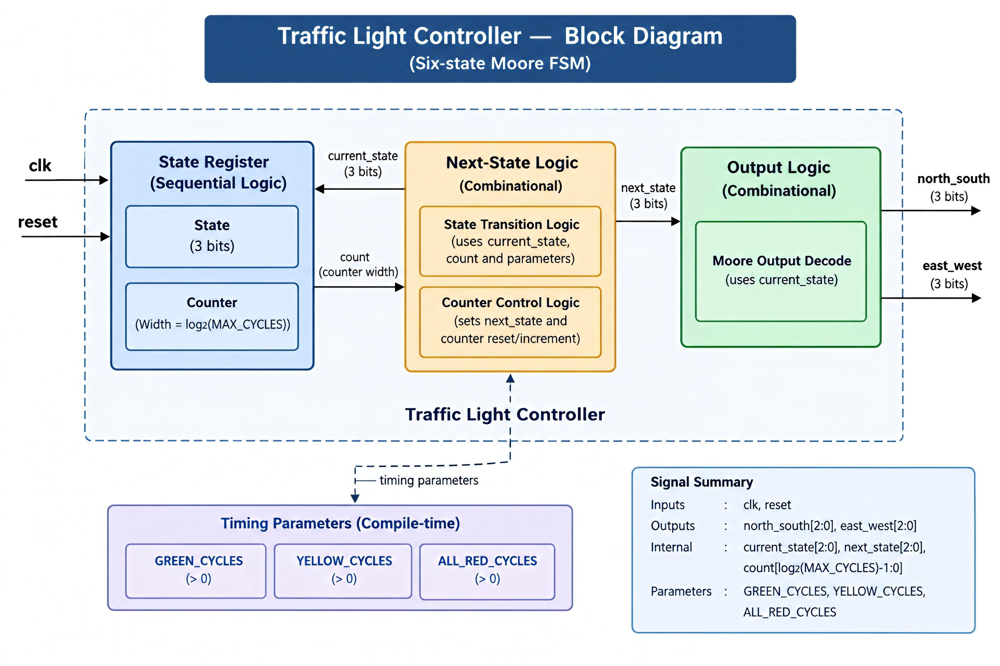
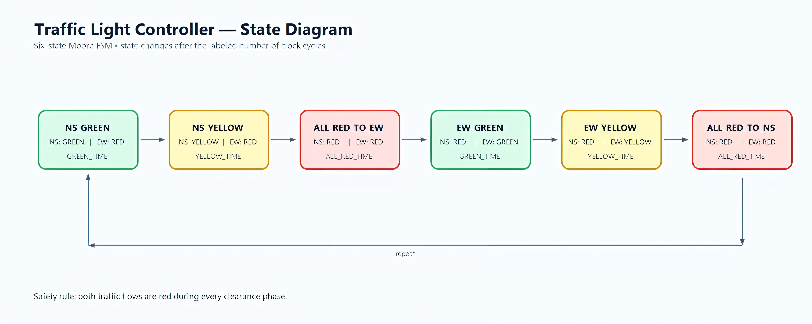
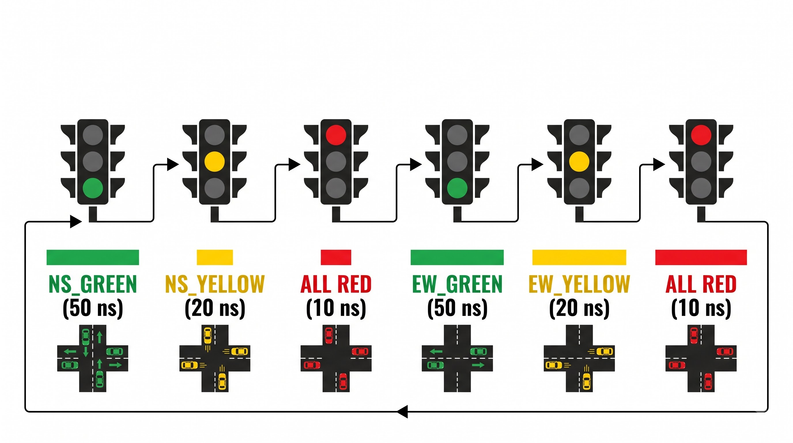
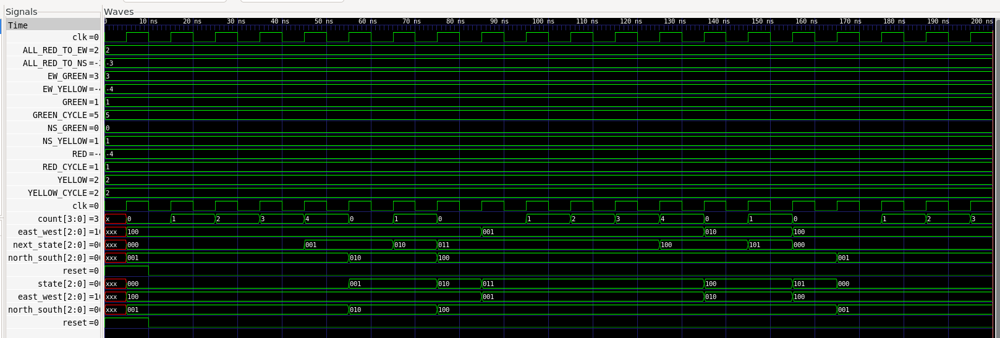
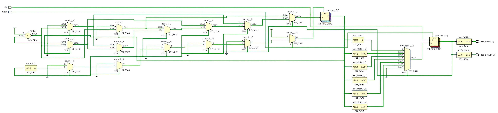

<div align="center">


Moore FSM • Floor Request Handling • Timed Door Control
<p>
  
  
  
  
</p>

</div>

📋 Introduction
Elevator controllers are digital control systems that manage floor requests, movement direction, door operation, and emergency conditions in a coordinated way. They use sequential logic to move between defined operating states and respond to user requests.
This project implements an Elevator Controller in Verilog HDL using a 7-state Moore Finite State Machine (FSM). The design includes floor-request handling, floor-by-floor movement, timed door control, emergency-stop handling, and a floor-display interface. The RTL is organized into separate modules to make the design easier to understand, simulate, and verify.
📌 Project Summary
- Architecture: 7-state Moore Finite State Machine (FSM)
- Design Language: Verilog HDL (Verilog-2001 style)
- Floor Support: Floor 0, Floor 1, and Floor 2
- Control Features: Synchronous reset, floor request handling, up/down movement, door timing, and latched emergency state
- Door Timing: Parameterized using DOOR_OPEN_CYCLES (default: 16)
- Verification Scope: Main-controller and submodule testbenches, functional simulation, and waveform inspection
🔌 Interface Specifications
[!NOTE]
Quick Interface Overview
The table below summarizes the top-level elevator_controller interface. The internal module behavior is handled by the RTL design modules.

Port	Direction	Width	Description
clk	Input	1	Master system clock
reset	Input	1	Synchronous active-high reset
floor_request	Input	2	Requested floor: 00, 01, or 10; 11 is invalid
emergency_stop	Input	1	Requests entry into the emergency state
current_floor	Output	2	Current floor number in binary
move_up	Output	1	Indicates upward movement state
move_down	Output	1	Indicates downward movement state
door_open	Output	1	Indicates door-open / door-timing state
floor_display	Output	2	Binary floor value for the display interface
emergency_active	Output	1	Indicates that the controller is in the emergency state


🏗️ Architecture
The elevator controller is organized around a state register, next-state logic, output decoding, and supporting modules. The floor-request handler stores a valid request, the door timer tracks the door-open interval, and the seven-segment display module decodes the floor value.
 
FSM State Diagram
The controller uses seven states:
State	Encoding	Purpose
IDLE	3'b000	Waits for a valid floor request
MOVE_UP	3'b001	Moves one floor upward per clock cycle while required
MOVE_DOWN	3'b010	Moves one floor downward per clock cycle while required
DOOR_OPEN	3'b011	Opens the door and clears the timer
DOOR_TIMER	3'b100	Keeps the door open while the timer runs
DOOR_CLOSE	3'b101	Closes the door and clears the completed request
EMERGENCY	3'b110	Holds the emergency state until reset


 
Timing Flow
The timing diagram can be used to inspect the relationship between clock edges, floor movement, door control, and the timer completion signal.
 
[!NOTE]
Detailed FSM Behavior
The FSM state names and encodings above follow the current RTL implementation. Use the project’s design documents and simulation results as the reference for detailed transition behavior.

💻 RTL Implementation
The RTL is divided into a top-level controller and supporting modules:
- Elevator Controller: Coordinates FSM transitions, floor movement, door output, and emergency handling.
- Floor Request Handler: Accepts valid floor requests (00, 01, 10), stores the requested floor, and clears completed requests.
- Door Timer: Counts clock cycles while timing is enabled and signals timer completion.
- Seven-Segment Display: Decodes floor values 00, 01, and 10 into segment patterns; the invalid floor code uses the default output pattern.
The controller uses separate sequential and combinational logic for state updates and next-state decisions. Default assignments are used in combinational output logic to avoid unintended latch inference.
The RTL source files and testbenches are available in
[03-rtl-design-and-verification/](./03-rtl-design-and-verification/).

<table align="center">
<tr>

<td align="center" width="50%">

<a href="./03-rtl-design-and-verification/rtl-design/01_elevator_controller.v">


Elevator Controller RTL
Synthesizable Verilog RTL
01_elevator_controller.v

<a href="./03-rtl-design-and-verification/rtl-design/01_elevator_controller.v">

</a>

</td>

<td align="center" width="50%">

<a href="./03-rtl-design-and-verification/testbench/01_elevator_controller_tb.v">


Elevator Controller Testbench
Simulation & Verification
01_elevator_controller_tb.v

<a href="./03-rtl-design-and-verification/testbench/01_elevator_controller_tb.v">

</a>

</td>

</tr>
</table>


🧪 Verification Strategy
The testbenches are used to check the main controller and supporting modules, including:
- Reset behavior and return to the initial IDLE state
- Floor movement for requests from Floor 0 to Floor 1 and Floor 2
- Downward movement from Floor 2 to Floor 1 and Floor 0
- A request for the current floor without unnecessary movement
- Door opening, timer completion, and return to the idle state
- Invalid floor request 2'b11
- Emergency-stop entry, request rejection during emergency, and reset recovery
- Floor-request handler acceptance, invalid-request rejection, and request clearing
- Door timer completion and clearing
- Seven-segment output patterns for Floors 0, 1, and 2
[!NOTE]
Verification Evidence
The simulation outputs from the main controller and individual module testbenches should be retained in the project’s verification-results folder. Only mark a test as passing when the corresponding simulation output confirms it.

📈 Simulation Evidence
Waveform
 
The waveform can be used to inspect state transitions, current floor, movement outputs, door control, request validity, and timer completion. Update the image path above if your saved waveform uses a different filename.
RTL Schematic
If an RTL schematic is generated using a synthesis tool, place the image in the verification-results folder and link it here. A schematic is not included by default because a confirmed image path was not provided.
📚 Documentation
- [Block Diagram](./02-architecture/01-block-diagram.png)
- [FSM State Diagram](./02-architecture/02-fsm-state-diagram.png)
- [Timing Diagram](./02-architecture/03-timing-diagram.png)
- [RTL Design and Verification Files](./03-rtl-design-and-verification/)
🧪 Verification & Simulation Results
The following summary reflects the test scenarios reported during project development. Refer to the latest simulation logs for the complete output.
Test Case	Scenario Description	Expected Behavior	Reported Result
TC_01	Reset	Controller returns to Floor 0 and IDLE	✅ PASS
TC_02	Floor 0 to Floor 2	Controller moves upward to Floor 2	✅ PASS
TC_03	Floor 2 to Floor 0	Controller moves downward to Floor 0	✅ PASS
TC_04	Floor 0 to Floor 1	Controller moves upward to Floor 1	✅ PASS
TC_05	Floor 2 to Floor 1	Controller moves downward to Floor 1	✅ PASS
TC_06	Current-floor request	Door opens without floor movement	✅ PASS
TC_07	Invalid floor request (2'b11)	Invalid request does not cause movement	✅ PASS
TC_08	Emergency stop	Controller enters and remains in emergency state until reset	✅ PASS
TC_09	Request during emergency	New request is ignored while emergency is active	✅ PASS
TC_10	Emergency reset recovery	Reset clears emergency and returns controller to IDLE	✅ PASS
TC_11	Floor request handler	Valid request, invalid request, and clear behavior checked	✅ PASS
TC_12	Door timer	Timer completion and clear behavior checked	✅ PASS
TC_13	Seven-segment display	Floor 0, Floor 1, and Floor 2 patterns checked	✅ PASS


Repository Structure
└── 05-Elevator-Controller/
    │
    ├── README.md
    │
    ├── 02-architecture/
    │   ├── 01-block-diagram.png
    │   ├── 02-fsm-state-diagram.png
    │   └── 03-timing-diagram.png
    │
    └── 03-rtl-design-and-verification/
        │
        ├── rtl-design/
        │   ├── 01_elevator_controller.v
        │   ├── 02_floor_request_handler.v
        │   ├── 03_door_timer.v
        │   └── 04_seven_segment_display.v
        │
        ├── testbench/
        │   ├── 01_elevator_controller_tb.v
        │   ├── 02_floor_request_handler_tb.v
        │   ├── 03_door_timer_tb.v
        │   └── 04_seven_segment_display_tb.v
        │
        └── verification-results/
            ├── simulation logs
            ├── VCD waveform files
            └── saved screenshots (if generated)
🛠️ Tools & Technologies
- HDL: Verilog HDL
- Simulation Engine: Icarus Verilog
- Waveform Debugger: GTKWave
- Synthesis / RTL Inspection: Xilinx Vivado (if used for schematic generation)
- Version Control: Git & GitHub
📚 Key RTL Concepts Applied
- Moore FSM Design: Outputs are decoded from the current state.
- Sequential Logic: State and floor registers update on the active clock edge.
- Combinational Next-State Logic: Determines the next FSM state from current inputs and status signals.
- Request Handling: Stores valid floor requests and clears completed requests.
- Counter-Based Timing: Uses a counter to determine when the door timer has completed.
- Emergency-State Retention: Keeps the controller in the emergency state until reset.
- Modular RTL Design: Separates the controller, request handler, timer, and display decoder.
- Testbench-Based Verification: Uses simulation to check expected controller and submodule behavior.
💬 Interview Questions
Q: Why is an FSM used in the elevator controller?
A: An FSM organizes the controller into clear operating states such as idle, movement, door timing, and emergency handling.
Q: Why is the requested floor stored separately?
A: The request handler holds the target floor while the controller decides how to reach it.
Q: Why is a timer used for the door?
A: The timer allows the controller to keep the door open for a defined number of clock cycles before closing it.
Q: What happens if the invalid floor code 2'b11 is requested?
A: The floor request handler does not accept that code as a valid request.
Q: How does the emergency state recover?
A: The controller remains in the emergency state until reset returns it to the initial state.
Q: Why split the design into multiple modules?
A: Separate modules make each function easier to understand, test, and debug.
⚖️ Design Decisions & Trade-offs
- Moore FSM: Makes controller behavior easier to reason about using explicit states.
- Separate Request Handler: Keeps request storage and validation outside the main controller.
- Dedicated Door Timer: Separates timing behavior from the FSM control logic.
- Modular Display Decoder: Keeps floor-display decoding independent of movement control.
- Synchronous Reset: Aligns state and register reset behavior with the clock.
- Three-Floor Scope: Keeps the current design focused on a compact elevator-control example.
🚀 Future Improvements
- Add a more advanced request scheduler for multiple queued floor requests.
- Add door obstruction detection and safe door reopening behavior.
- Add input synchronization and debouncing for physical buttons.
- Add assertions and broader automated coverage for edge cases.
- Generate and include a verified RTL schematic and annotated waveform screenshot.
- Extend the design to support more floors using parameterized floor width and movement logic.
🔗 Related
Part of the [RTL Mini-Projects](../README.md) collection.
This project builds practical experience in FSM design, sequential logic, request handling, counter-based timing, modular Verilog RTL, and simulation-based verification.


---


<div align="center">


<br>

### Moore FSM • Timed State Transitions • Synthesizable RTL

<p>
  
  
  
  
</p>

</div>

---

## 📋 Introduction

Modern embedded systems and digital controllers rely heavily on robust sequential logic to manage timed operations reliably. A prime example of this is a traffic-light controller, which governs the safe flow of intersection traffic by transitioning systematically through a pre-determined sequence of signal states. 

This project implements a fully synthesizable **Traffic-Light Controller in Verilog HDL** utilizing a **3-state Moore Finite State Machine (FSM)** architecture. In a Moore machine, outputs are strictly a function of the current state, ensuring deterministic behavior and glitch-free signal transitions. Designed for industrial synthesis and FPGA/ASIC deployment, the architecture features a clean separation of state memory, next-state logic, and output decoding.

---

## 📌 Project Summary

* **Architecture:** 3-state Moore Finite State Machine (FSM)
* **Design Language:** Verilog RTL (IEEE 1364-2005 compatible)
* **Control Features:** Synchronous active reset, edge-triggered clocking, and timed state progression
* **Verification Scope:** Self-checking testbench, functional simulation, and waveform timing analysis

## 🔌 Interface Specifications

> [!NOTE]
> **Quick Interface Overview**
> Full architectural details, FSM specifications, and trade-offs are available in the [Requirements & Design](./01-docs/01-requirements-and-design.md) document.

| Port | Direction | Width | Description |
| :--- | :--- | :--- | :--- |
| `clk` | Input | 1 | Master system clock |
| `reset` | Input | 1 | Synchronous active-high reset |
| `light` | Output | 3 | One-hot encoded traffic lights `{Red, Yellow, Green}` |


## 🏗️ Architecture

The controller consists of a state register, next-state logic, and output
logic. The FSM changes state on the active clock edge and generates the
corresponding traffic-light output based on the current state.



### FSM State Diagram



### Timing Flow



> [!NOTE]
> **Detailed FSM Behavior**
> Complete architectural and state-transition details are documented in the [FSM Specification](./01-docs/02-fsm-specification.md).

## 💻 RTL Implementation

The RTL implementation follows strict synthesizable coding standards:

- Separated 2-process FSM modeling (Sequential state/timer registers + Combinational next-state/output logic)
- One-hot state encoding (`S_RED=3'b001`, `S_GREEN=3'b010`, `S_YELLOW=3'b100`) for minimal combinational decode logic and maximum $F_{max}$
- Full case coverage with defensive `default` branches to guarantee zero inferred latches
- Fully synchronous active-high reset aligned with the system clock tree
- Parameterized state dwell times (`RED_CYCLES`, `GREEN_CYCLES`, `YELLOW_CYCLES`)

The Verilog RTL and testbench are available in
[rtl-tb/](./03-rtl-tb).

<br>

<table align="center">
<tr>

<td align="center" width="50%">

<a href="./03-rtl-tb/traffic_light_controller.v">


<br><br>


<br>

### Traffic Light RTL

**Synthesizable Verilog RTL**

`traffic_light_controller.v`

<br>
<a href="./03-rtl-tb/traffic_light_controller.v">


</a>

</td>

<td align="center" width="50%">

<a href="./03-rtl-tb/traffic_light_controller_tb.v">


<br><br>


<br>

### Traffic Light Testbench

**Simulation & Verification**

`traffic_light_controller_tb.v`

<br>

<a href="./03-rtl-tb/traffic_light_controller_tb.v">


</a>

</td>

</tr>
</table>

<br>

## 🧪 Verification Strategy

The dedicated testbench is used to verify:

- Synchronous reset assertion and de-assertion latency
- Cycle-accurate timing verification across all state intervals
- State transition sequence ordering without intermediate invalid states
- Output vector integrity (`light` bus exclusivity: never multiple lights ON simultaneously)
- Extended endurance testing (50+ continuous cycles) verifying terminal recovery and zero deadlock
- Self-checking assertion checks with automated `$error` tracking and summary reporting

> [!NOTE]
> **Detailed Verification Plan**
> Comprehensive verification planning and test results are documented in the [Verification Summary](./01-docs/03-verification-summary.md).

## 📈 Simulation Evidence

### Waveform



The waveform is analyzed to compare the expected FSM behavior with the actual
simulation output.

### RTL Schematic



The RTL schematic provides a hardware-oriented view of the structures inferred
from the Verilog RTL.

## 📚 Documentation

- [Requirements & Design](./01-docs/01-requirements-and-design.md)
- [FSM Specification](./01-docs/02-fsm-specification.md)
- [Verification Summary](./01-docs/03-verification-summary.md)
- [Design Decisions & Trade-offs](./01-docs/04-design-decisions.md)

## 🧪 Verification & Simulation Results

| Test Case | Scenario Description | Expected Behavior | Actual Behavior | Status |
| :--- | :--- | :--- | :--- | :--- |
| **TC_01** | Reset Assertion during active run | Immediate return to `S_RED` (`light=3'b100`) | Forced to `S_RED` within 1 cycle | ✅ PASS |
| **TC_02** | Red State Timing Hold | Light remains Red for exactly 6 clock cycles | Counter holds state for 6 cycles | ✅ PASS |
| **TC_03** | Sequential Transition Integrity | Sequenced through `RED -> GREEN -> YELLOW -> RED` | Deterministic cycle sequence verified | ✅ PASS |
| **TC_04** | Terminal Recovery Verification | Continuous execution across 50 full cycles | Zero state lockup or illegal states | ✅ PASS |

## Repository Structure

```text
└── 01-traffic-light-controller/
    │
    ├── README.md
    │
    ├── 01-docs/
    │   ├── 01-requirements-and-design.md
    │   ├── 02-fsm-specification.md
    │   ├── 03-verification-summary.md
    │   └── 04-design-decisions.md
    │
    ├── 02-architecture/
    │   ├── 01-block-diagram.png
    │   ├── 02-state-diagram.png
    │   └── 03timing-flow.png
    │
    └── 03-rtl-tb/
        ├── README.md
        ├── traffic_light_controller.v
        ├── traffic_light_controller_tb.v
        ├── rtl-schematic.png
        └── waveform.png
```

## 🛠️ Tools & Technologies

- **HDL:** Verilog HDL 
- **Simulation Engine:** Icarus Verilog 
- **Waveform Debugger:** GTKWave 
- **Synthesis & Linting:** Xilinx Vivado / Verilator
- **Version Control:** Git & GitHub

## 📚 Key RTL Concepts Applied

- **Moore FSM Topology:** Decoupled input-to-output combinational paths for hazard-free outputs.
- **One-Hot State Encoding:** Minimized next-state decode logic depth to reduce critical path delay.
- **Deterministic Reset Recovery:** Synchronous reset architecture eliminating removal/recovery metastability issues.
- **Latch Prevention Disciplines:** Full default assignments and comprehensive case item branching.
- **Self-Checking Verification:** Automated testbenches using tasks, loop assertions, and status counters.
- **Static Timing Awareness:** Registering boundaries to maintain clean setup and hold slack margins.

## 💬 Interview Questions

**Q: Why is a Moore FSM used for this design?**  
A: The traffic-light output depends only on the current FSM state, providing
predictable and state-based output behavior.

**Q: Why use synchronous reset?**  
A: The reset is sampled with the clock, allowing the FSM to return to its
initial state synchronously.

**Q: Why are default assignments important in combinational logic?**  
A: Default assignments ensure signals receive defined values and help prevent
unintended latch inference.

**Q: What happens during a state transition?**  
A: The next-state logic determines the upcoming state, and the state register
updates on the active clock edge.

**Q: How can this controller be extended?**  
A: Additional inputs and states can be introduced for features such as
pedestrian crossing, emergency priority, or multi-intersection control.

## ⚖️ Design Decisions & Trade-offs

- **Moore FSM:** Provides predictable state-dependent outputs.
- **Synchronous reset:** Keeps reset behavior aligned with the system clock.
- **Separated FSM logic:** Improves readability, simulation, and debugging.
- **Fixed state sequence:** Keeps the initial design focused on fundamental
  FSM-based RTL implementation.

> [!NOTE]
> **Design Decisions & Trade-offs**
> Comprehensive architectural choices, rationale, and trade-offs are detailed in the [Design Decisions & Trade-offs](./01-docs/04-design-decisions.md) document.

## 🚀 Future Improvements

- Fully parameterized cycle registers accessible via an AMBA APB slave bus interface.
- Dual-axis intersection support (North-South / East-West) with conflicting-green hardware interlocks.
- Pedestrian crossing request synchronizer with debounce filtering.
- Emergency vehicle preemption logic with priority interrupt override.

## 🔗 Related

Part of the [RTL Mini-Projects](../README.md) collection.

This project strengthens practical FSM and RTL design skills and provides a
foundation for larger control-oriented digital hardware projects.


