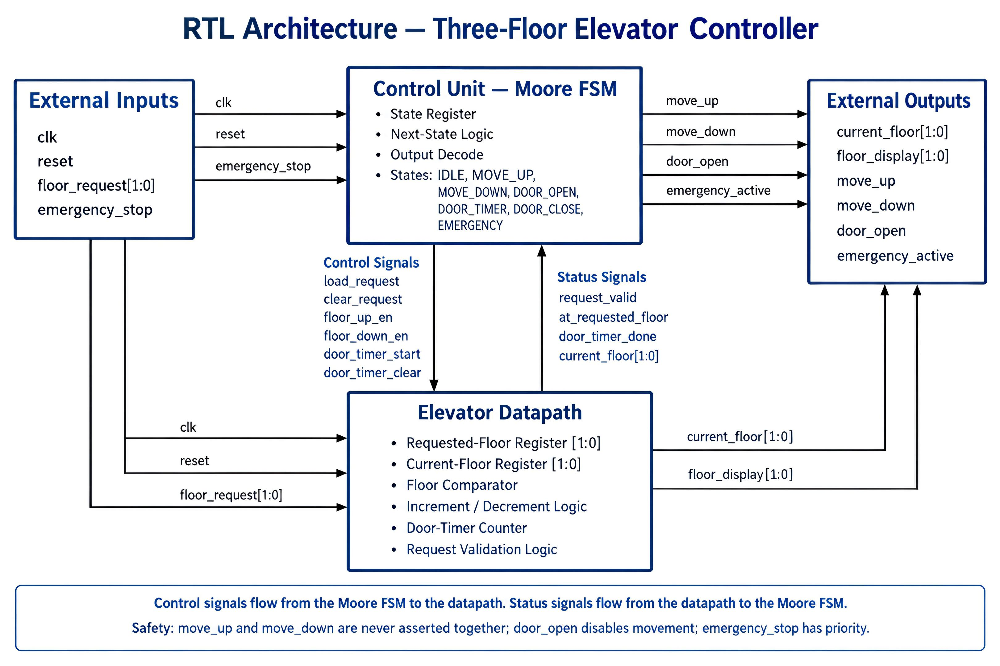
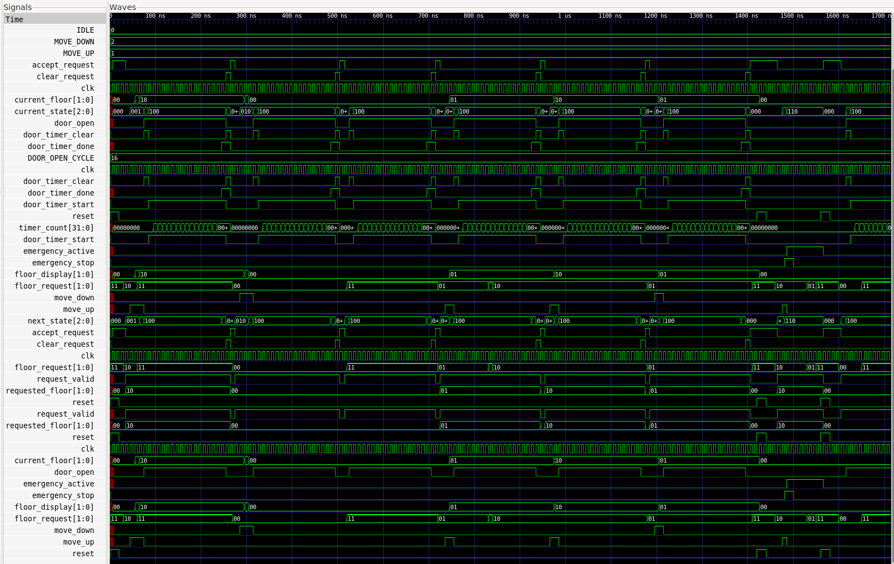

# Elevator Controller — Architecture

This document outlines the system architecture of the Elevator Controller project. It is broken down into three main views: the **RTL Block Architecture**, the **FSM State Diagram**, and the **Timing Flow**, providing a clear overview of how the system is structured and how it operates.

---

## 1. RTL Block Architecture

The block diagram illustrates the modular structure of the elevator system and the communication between its sub-components. The design uses a clean, hierarchical approach where the main controller coordinates inputs, timing, and display outputs.


---

## 2. FSM State Diagram

The control core is implemented as a Finite State Machine (FSM). It transitions between operational states to handle floor travel, door timers, and safety features. 

The primary state flow is:

`IDLE → (MOVE_UP / MOVE_DOWN) → DOOR_OPEN → DOOR_TIMER → DOOR_CLOSE → IDLE`

- **`IDLE`**: Waits for user floor requests.
- **`MOVE_UP` / `MOVE_DOWN`**: Actuates the motor and updates the current floor level.
- **`DOOR_OPEN` & `DOOR_TIMER`**: Opens the door and holds it open for a set duration.
- **`DOOR_CLOSE`**: Closes the door and returns to idle.
- **`EMERGENCY`**: Overrides normal operation instantly when triggered.



---

## 3. Timing Flow

The timing flow describes how signals change over clock cycles during normal operation. 

Default project configuration parameters:
- Clock period: `10 ns`
- Door open dwell time: `DOOR_OPEN_CYCLE = 16` clock cycles
- Floor-to-floor transition: `1 clock cycle per floor level`



---

## Architecture Summary

```text
Floor Requests / Emergency Inputs
              ↓
     Floor Request Handler
              ↓
       Main FSM Control
              ↓
     Datapath & Door Timer
              ↓
  Motor Signals & 7-Segment Display
